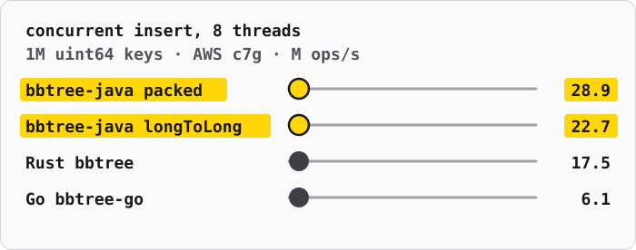
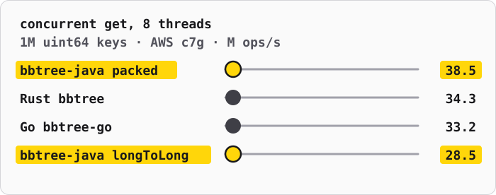

# bbtree-java

[](https://github.com/sbailliez/bbtree-java/actions/workflows/ci.yml)
[](LICENSE)

**bbtree-java is a fast concurrent sorted map for the JVM.** It brings the design of
[bbtree](https://github.com/XiangpengHao/bbtree), the Rust ordered map by
[Xiangpeng Hao](https://xiangpeng.systems/), to Java: a B+ tree with inline keys and optimistic
lock coupling.

This is a hobby port, made for fun with Claude Opus 5.5 (medium effort). The aim was to see how
close Java can get to the performance of the Rust original and of its Go port,
[bbtree-go](https://github.com/richardartoul/bbtree-go). The performance was measured on AWS
c7g.4xlarge (Graviton3), c8a.4xlarge (AMD Zen 5) and c7i.4xlarge (Intel Sapphire Rapids), and on
an Apple M5 Pro (local). All the credit for the design goes to Xiangpeng Hao. The port can
certainly be made faster: batch lookups still take 1.7 to 4.0 times the Rust time, and
[Possible next steps](#possible-next-steps) lists ideas that are not done yet.

1. **Close to the Rust original.** On AWS Graviton3, `PackedLongMap` lookups and inserts on one
   thread take at most 6% more time than in the Rust bbtree. With 8 threads, its inserts were
   1.4 to 1.6 times faster than Rust on Graviton3, AMD Zen 5 and Intel Sapphire Rapids. Rust
   stays ahead on x86 lookups and on batch lookups (see below).
2. **Many times faster than the JDK maps.** With 16 threads, `BBTreeMap` does 3.6 to 5.4 times the
   throughput of `ConcurrentSkipListMap`. On one thread, its lookups are 1.8 to 3.6 times faster
   than `TreeMap`, and its scans 9 to 11 times faster (Apple M5).
3. **A drop-in `ConcurrentMap`.** `BBTreeMap` implements `java.util.concurrent.ConcurrentMap`.
   Use it where you use `ConcurrentSkipListMap`, or a `TreeMap` behind a lock.
4. **Choose your trade-off.** Six kinds of map, from any key type to `long` keys and `long` values
   with no objects at all. `BBTrees` makes each one.
5. **Zero dependencies.** Java 21 or later. The optional Vector API module needs Java 25.
6. **Many tests.** About 3,000 tests: the `ConcurrentMap` contract suites of Guava, differential
   tests against `TreeMap`, and concurrency tests on Arm and x86. Deliberate defects in the lock
   paths make the tests fail.





The charts show AWS c7g (Graviton3), 1M `uint64` keys, the workloads of bbtree-go, median of 6
rounds. On Zen 5 and Sapphire Rapids, single-thread lookups take 1.3 to 2.8 times the Rust time,
and on all three CPUs batch lookups take 1.7 to 4.0 times.
[docs/cross-language.md](docs/cross-language.md) gives all results on four CPUs.

The design is explained in the post [bbtree: fastest ordered map](https://bbtree.xiangpeng.systems/post/).

## Usage

Java 21 or later is necessary for the core module `bbtree`. It has no runtime dependency. The
optional module `bbtree-vector` needs Java 25.

```java
import io.github.sb.bbtree.BBTreeMap;
import io.github.sb.bbtree.InlineKey;

// Give an InlineKey for the fast configuration.
BBTreeMap<Long, String> map = new BBTreeMap<>(InlineKey.LONG);
map.put(42L, "answer");
map.get(42L);                                  // "answer"

// Look up many keys in one call. The lookups go down the tree together.
Long[] keys = {1L, 42L, 7L};
String[] values = new String[keys.length];
map.getMany(keys, values);                     // [null, "answer", null]

// Read a range in key order. The second form stops when the action gives false.
map.forEachInRange(0L, 100L, (k, v) -> System.out.println(k + "=" + v));
map.forEachInRangeWhile(0L, null, (k, v) -> k < 10);

// Without an InlineKey, the map uses the natural order or a Comparator.
BBTreeMap<String, String> reversed = new BBTreeMap<>(Comparator.reverseOrder());
```

For `long` keys, `LongBBTreeMap` takes primitive keys. A lookup with a primitive key reads no
key object, so it saves the cache miss of the boxed `Long`:

```java
LongBBTreeMap<String> ids = new LongBBTreeMap<>();
ids.put(42, "answer");
ids.get(42);                                   // "answer"
ids.getMany(new long[] {1, 42}, new String[2]);
ids.asMap();                                   // the same entries as a BBTreeMap<Long, String>
ids.forEachFrom(40, (k, v) -> k < 50);         // a scan that reads no key object
```

For `long` keys and `long` values, `LongLongBBTreeMap` keeps the values in a `long[]` in each
leaf, so a hit reads no value object. A map cannot hold `null`, so each method that can find no
entry takes the value to give back in that case:

```java
LongLongBBTreeMap counts = new LongLongBBTreeMap();
counts.put(42, 7, -1);                         // -1: there was no old value
counts.get(42, -1);                            // 7
counts.get(43, -1);                            // -1
counts.getMany(new long[] {42, 43}, new long[2], -1);   // [7, -1]
```

On Graviton3, Zen 5 and Sapphire Rapids, with 1M entries, `LongLongBBTreeMap` made `uint64` hits
23% to 40% faster than `LongBBTreeMap<Long>`, batch lookups 18% to 31% faster, and scans of 64
entries 58% to 67% faster.

On Linux, run the JVM with `-XX:+UseTransparentHugePages`. With 2 MB pages, the TLB walks of a
lookup on Graviton3 went from 2.8 to 0.01, lookups became 13% faster and inserts 12% to 14%
faster. The JMH benchmarks set it, together with `-XX:+IgnoreUnrecognizedVMOptions`, so that
they also start on macOS, where the option does not exist.

The built-in inline keys are `LONG`, `INTEGER`, `UUID`, `STRING`, and `BYTES` (`byte[]` in
unsigned order). For a key type of your own, implement `InlineKey`. Its Javadoc gives the
contract, and `InlineKeyContractTest` gives a check that you can copy.

## Which map to use

The Rust bbtree keeps each key and each value by value in its node pages. A Java map of any key
type keeps references: to a key object, to a value object, and to the arrays of each node. Each
reference that a lookup follows can be a cache miss. The kinds of map below remove these objects
one step at a time. `BBTrees` makes each kind, and its Javadoc gives the same trade-offs.

| Factory method | Class | Keys | Values | What a lookup reads | `Map` view |
|---|---|---|---|---|---|
| `BBTrees.naturalOrder()`, `BBTrees.ordered(comparator)` | `BBTreeMap` | any | any | key objects in each node | yes |
| `BBTrees.inline(InlineKey)` | `BBTreeMap` | with an encoding: `long`, `int`, `UUID`, `String`, `byte[]`, your own | any | windows; a key object only on a tie | yes |
| `BBTrees.longKeys()` | `LongBBTreeMap` | `long` | any | windows, then the value object | `asMap()` |
| `BBTrees.longToLong()` | `LongLongBBTreeMap` | `long` | `long` | windows, then a `long[]` of values | `asMap()` |
| `BBTrees.packed()` | `PackedLongMap` | `long` | `long` | one `long[]` per node with the keys and the values | no |
| `VectorBBTreeMaps.create(...)` (module bbtree-vector) | `BBTreeMap` | as `inline` | any | as `inline`, with a Vector API search | yes |

Measured differences, with 1M entries:

- `inline` against `naturalOrder`: `get` of `long` keys took 286 ns against 476 ns on the Apple
  M5 (`GetBenchmark`, the results below).
- `longToLong` against `longKeys` with `Long` values, with the workloads of the Java, Go and Rust
  comparison on Graviton3, AMD Zen 5 and Intel Sapphire Rapids: `uint64` hits 23% to 40% faster,
  batch lookups 18% to 31% faster, scans of 64 entries 58% to 67% faster.
- `packed` against `longToLong`, with the same workloads and machines: hits 25% to 48% faster,
  inserts 22% to 40% faster, scans 15% to 50% faster, batch lookups between 7% slower and 22%
  faster. With the removal of empty nodes, deletes were 39% to 55% faster.
- The vector maps were slower than the scalar maps on Graviton3, Zen 5 and Sapphire Rapids
  ([docs/node-search-cpus.md](docs/node-search-cpus.md)), and faster for cold lookups on the
  Apple M5.

The costs of each step:

- `BBTreeMap` takes any key and value type and is a full `ConcurrentMap`.
- `LongBBTreeMap` and `LongLongBBTreeMap` keep a `Long` object for each key, for the separators
  and the `Map` view, so their memory per entry is larger than that of `packed`.
- `PackedLongMap` takes only `long` keys and `long` values, and has no `Map` view. A removal that
  empties a leaf removes the empty nodes, as in `BBTreeMap`; neither map merges nodes that are not
  empty.

### Use cases

**bbtree in general** fits a sorted map that many threads read and write at the same time, and
that needs ordered access: ranges, the next key, scans in key order. Use it in place of a
`ConcurrentSkipListMap`, or of a `TreeMap` behind a lock. On the M5 (the results below), `get`
was 1.8 to 3.6 times faster than `TreeMap`, and 4.1 to 8.7 times faster with `getMany`. Scans of
100 entries were 9 to 11 times faster, and 16 threads did 27 to 47 million operations per second
against 6 to 9.5 million for `ConcurrentSkipListMap`.

Examples:

- **An in-memory index with range queries.** A service keeps its records in memory, keyed by a
  sortable value such as a name, a path or a URL, and answers queries such as "all entries from
  `a` to `b`" or "the 50 entries after this cursor". Request threads read the index while a
  loader thread adds and updates records. A `HashMap` cannot answer a range, and a
  `ConcurrentSkipListMap` follows one pointer for each key that it compares. Use
  `BBTrees.inline(InlineKey.STRING)`, and `forEachInRange` or `iterator` for the ranges.
- **A secondary index of a database or a cache.** The primary data is keyed by ID, and the index
  maps another attribute to the IDs, for example the email of a user to the user ID, or a
  composite of a tenant ID and a creation time to an order ID. The index must find one key fast
  and must also list all keys of one tenant in order. Encode the composite key as a `byte[]` and
  use `BBTrees.inline(InlineKey.BYTES)`, or give a `Comparator` to `BBTrees.ordered` if the key
  has no simple encoding.
- **A time-ordered index of events.** Events arrive with a timestamp or a sequence number, and
  readers ask for "the events after time t" or "the first event at or after t". The keys arrive almost
  in ascending order, which the append split handles: the leaves stay almost full. With `long`
  keys and an offset or a position as the value, for example the offset of the event in a log
  file, use `BBTrees.packed()`. With UUID v7 keys and event objects as values, use
  `BBTrees.inline(InlineKey.UUID)`.
- **An order book.** A trading engine keeps, for each price level, the quantity that is offered.
  It must find the best price, walk the levels in price order, and change quantities while other
  threads read the book. The maps iterate in ascending order only, so keep the bids with the
  price negated, so that the best bid is the first key. With the price as a `long` number of ticks
  and the quantity as a `long`,
  use `BBTrees.packed()`, and remove a level when its quantity becomes 0.
- **A map that many threads share.** Any sorted map that one lock protects today, for example
  sessions sorted by expiry time that a cleaner thread scans, while request threads add and touch
  sessions, with the expiry time and the session ID as a composite key. A write locks only the
  leaf that it changes, plus the parent when the leaf splits, and a read takes no lock.

A sorted map is not the best choice when:

- the map needs no order: a `HashMap` or a `ConcurrentHashMap` does not compare keys at all;
- the map is small and only one thread uses it: a `TreeMap` stays in the cache;
- the workload removes most of its keys: this port merges only empty nodes (`BBTreeMap`), or no
  nodes (`PackedLongMap`), so a map that shrinks keeps sparse nodes.

**Each kind:**

- `BBTrees.naturalOrder()` and `BBTrees.ordered(comparator)`: keys that have no order-preserving
  encoding, for example a composite key with a custom `Comparator`. It is still faster than a
  `ConcurrentSkipListMap` (476 ns against 1,910 ns for `long` lookups on the M5).
- `BBTrees.inline(InlineKey)`: the general choice for keys with an encoding: `UUID` primary keys,
  URLs and paths, `byte[]` keys of a storage engine, `int` and `long` keys with object values when
  a `Map<K, V>` API is necessary. Time-ordered keys, such as UUID v7, fill the leaves with the
  append split.
- `BBTrees.longKeys()`: `long` IDs or timestamps that map to objects, when the caller has the key
  as a primitive `long`. It avoids the boxing and the cache miss of a `Long` key.
- `BBTrees.longToLong()`: `long` to `long` maps that also need a `Map<Long, Long>` view or full
  removal semantics: counters, offsets, an ID to an ID.
- `BBTrees.packed()`: the fastest `long` to `long` index, where the map only grows or changes
  values: a timestamp to a file offset, a sequence number to a position, a price level to a
  quantity. It has no `Map` view.
- `VectorBBTreeMaps` (module bbtree-vector): experiments with the Java Vector API. On the CPUs of
  the measurements, it was faster only for lookups of cold keys on Apple silicon.

## How it works

The post on bbtree ranks the costs of a lookup: first the cache misses, then the
instructions, then the cache coherence traffic. Each item below decreases one of these costs.

1. **Inline keys.** Each node keeps a `long[]` of 8-byte windows, one for each key. A window is
   the part of the order-preserving encoding of the key that starts after the prefix that all
   keys of the node share. One cache line holds 8 windows. The node reads a key object only when
   two windows are equal. For `Long`, `Integer`, and the second half of a `UUID`, equal windows
   mean equal keys, and the lookup reads no key object at all.
2. **Prefixes from the fences.** All keys of a node sort between the two separators of the node
   in its parent. Thus the node prefix is the common prefix of these two separators, and no node
   stores the prefix bytes. Keys with long shared prefixes, such as URLs, still get useful
   windows.
3. **A linear scan of the windows.** A node search scans the sorted windows and stops at the
   first window that is not smaller than the target. The Rust bbtree counts the smaller windows
   with SIMD and no branch. C2 does not vectorize that count on AArch64, and in JMH the scan
   with an early exit was 11% to 22% faster for `get`.
4. **Optimistic lock coupling.** Each node has a version. A reader reads the version, reads the
   node, and makes sure that the version did not change. A read writes no shared cache line. A
   writer locks one leaf, plus the parent when a node splits. A full inner node splits on the way
   down, so a split always has room in its parent.
5. **The garbage collector replaces the free list.** The Rust bbtree keeps freed nodes on a free
   list, because a late reader can still read a freed node. On the JVM, a node stays alive while
   a reader holds it. For the same reason, readers read leaves optimistically too: a value is a
   reference that the garbage collector keeps valid.
6. **Interleaved batch lookups.** `getMany` moves 16 lookups down the tree one level at a time.
   Java has no prefetch instruction, and an acquire load stops later loads. Thus each level
   first searches all lanes and loads each child with a plain load, which starts the cache misses
   together. Then it reads the versions and validates the lanes.
7. **Windows on split without key reads.** If the prefix of a half does not change, the half
   copies its windows. For `Long`, `Integer`, and `UUID`, a window holds the whole rest of the
   key. When a split makes the prefix of a half longer, the new windows are the old windows
   shifted to the left. In both cases the split reads no key object.
8. **Append splits.** When a key goes after the last key of the rightmost node, the split moves
   only the last key. Ascending keys, such as UUID v7 or sequence numbers, fill the leaves to 31
   of 32 entries, not to half.

## Differences from the Rust bbtree

- No SIMD in the core, because the Vector API is an incubator module. The module `bbtree-vector`
  has a Vector API search with 4-byte inner windows. It made `get` 9% to 24% faster than the
  scalar map on the machine of the measurements (see below).
- Removal removes empty nodes only. An empty leaf merges with a sibling, an empty inner node gives
  its child to a sibling (or takes one from a full sibling), and a root with one child gives its
  place to the child. A map that becomes empty goes back to one leaf. The Rust bbtree also
  merges nodes that are less than 1/8 full. This port does not, so a map with few keys that are
  far apart can keep many sparse leaves.
- There is no single-thread variant, no memory-mapped file format, and no write-ahead log.
- `size()` comes from a `LongAdder`. It is exact when no write runs at the same time.

### Possible next steps

A review of the [design documents](https://github.com/XiangpengHao/bbtree/tree/main/design)
of the Rust bbtree found these gaps. The numbers are those of the Rust design documents, not
measurements of this port:

- **A node layout with fewer objects.** A lookup level reads the node object, then its `long[]`
  of windows, then its `children` array: three dependent loads, where the Rust page has two.
  Estimated gain: 20% to 30% of `get`. It needs a rewrite without the `Node` classes.
- **A prefix for the whole tree (D50).** The root and the border nodes have no fence on one side,
  so their prefix is 0. Keys with a shared start, such as URLs, tie on every window there. Rust:
  path lookups 426 to 375 ns.
- **Hash tags (D36).** A 1-byte tag from the hash of the key would avoid most key reads of a
  string hit or miss. Rust: path hits −10.7%, misses −31.2%.
- **A string encoding of 1 byte for each ASCII character.** `InlineKey.STRING` uses UTF-16, so an
  8-byte window holds only 4 characters.
- **An append to the last leaf without a descent (D45).** Rust: 10M ordered `u64` inserts 31.1 to
  5.3 ns.
- **A batch insert (D53)** and an atomic update-or-insert in one descent. `putAll`, `merge` and
  `compute` use the defaults of `AbstractMap` and `ConcurrentMap`.
- **A reader that waits at a locked leaf** in place of a new descent from the root, for leaves
  that many threads write.
- **Short separators**, and an end split that also applies inside the key space.
- **A test with a controlled thread schedule**, such as Lincheck. The Rust design records 2 races
  that only a controlled scheduler found.

## Tests

`mvn verify` runs approximately 3,000 tests:

| Test | What it does |
|---|---|
| `InlineKeyContractTest` | Compares each built-in `InlineKey` with a reference byte encoding: order, windows at each offset, common prefix. |
| `DifferentialTest` | Runs 60,000 random operations for each of 15 configurations against a `TreeMap`, including maps with 4-byte inner windows and keys that tie on 4 bytes. Every 2,000 operations, it checks the tree structure and that no empty leaf remains. |
| `BBTreeMapTest` | Unit tests: ranges, iterators, `getMany`, compaction, ascending loads, and exceptions from user code, which must leave no lock held. |
| `ConcurrencyTest` | Readers, iterators, and batch lookups run while writers split nodes and empty whole subtrees. Steady keys must never disappear. Also atomic `merge` and single removal. |
| `LongBBTreeMapTest`, `LongLongBBTreeMapTest` | The primitive APIs against a `TreeMap`, with keys at every prefix length and at `Long.MIN_VALUE` and `Long.MAX_VALUE`, and scans while writers split and empty leaves. |
| `PackedLongMapTest` | `PackedLongMap` against a `TreeMap` with the same key sources, an ascending load, and lookups of steady keys while writers split leaves everywhere. |
| `BBTreesTest` | Each factory method makes a working map. |
| `GuavaMapContractTest` | The `ConcurrentMap` contract suites of guava-testlib, for 3 configurations. |

Small nodes (4 entries) in most tests make splits and leaf removals frequent.

## Benchmarks

The benchmarks use JMH. Build them and run one class:

```sh
mvn -B package -DskipTests
java -jar bbtree-benchmarks/target/benchmarks.jar GetBenchmark
java -jar bbtree-benchmarks/target/benchmarks.jar ConcurrentBenchmark -t 16
```

| Class | What it measures |
|---|---|
| `GetBenchmark` | Lookups, half of them misses, in a map of 1M keys. `getBatch` sends 64 keys to `getMany`. |
| `PutBenchmark` | The build of a map of 1M keys, as time per insert. |
| `ScanBenchmark` | 100 entries after a random key. |
| `ConcurrentBenchmark` | Throughput of shared lookups, and of 90% lookups with 10% puts. |
| `LongKeyBenchmark` | Lookups of `long` keys as spread `Long` objects, as boxed `long` values, and with `LongBBTreeMap`. |
| `WindowWidthBenchmark` | One node search over windows of 8, 4 or 2 bytes, scalar and vector, in the cache and out of it. |
| `NodeSearchBenchmark` | One node search with the windows in the L1 cache: the scalar scan and the two vector scans. |
| `CrossLanguage` | The workloads of [bbtree-go](https://github.com/richardartoul/bbtree-go), with the same flags and output, to compare Java with Go and Rust. See below. |

The `impl` values are `bbtree`, `bbtree-narrow` (scalar, with 4-byte inner windows),
`bbtree-vector-scan`, `bbtree-vector-count`, `bbtree-vector-count-wide` (8-byte inner windows),
`bbtree-noinline`, `treemap`, `skiplist`, and `rwlock-treemap`. The key types are `long`,
`dense` (the integers 0 to n − 1), `uuid4` (random UUID), `uuid7` (time-ordered UUID, in time
order), and `string` (URL-like, with a 29-character shared prefix). The `impl` parameter also accepts
`bbtree-<leaf>x<inner>`, for example `bbtree-64x64`, to compare node capacities.

### Results

Apple M5 Pro (6 performance and 12 efficiency cores), Corretto 25.0.4, 8 GB heap, 1M keys. The
machine also ran other builds, at a load average between 6 and 10, and 25 at the end. macOS can
move a benchmark thread to an efficiency core when the machine is busy. Thus the error of a cell
is often 10% to 50%, and two runs can differ by 30%. Compare the maps within one table, and run
the benchmarks on a quiet machine before you depend on a number.

Lookups on one thread, half of them misses, in ns per lookup (less is better). For bbtree, the
number in parentheses is `getMany` with 64 keys a call, per key. For the other maps, a batch is
64 calls to `get`. The lookup keys are `Long`, `UUID` and `String` objects spread in memory.

| Keys | bbtree | bbtree, no inline keys | TreeMap | ConcurrentSkipListMap |
|---|--:|--:|--:|--:|
| `long` | 286 (116) | 476 (288) | 881 | 1,910 |
| `uuid4` | 320 (131) | 496 (284) | 1,142 | 2,023 |
| `uuid7` | 247 (108) | 263 (196) | 444 | 583 |
| `string` | 440 (183) | 815 (712) | 1,239 | 2,545 |

`long` lookups, by the form of the key, in ns per lookup (`LongKeyBenchmark`, 2 forks):

| Key form | bbtree | TreeMap | ConcurrentSkipListMap |
|---|--:|--:|--:|
| `Long` objects spread in memory | 291 | 883 | 1,745 |
| `long` values, boxed for the call | 129 | 780 | 2,671 |
| `long` values with `LongBBTreeMap` | 136 | - | - |

A spread `Long` costs a cache miss before the search starts. A freshly boxed `Long` is in the
cache, so autoboxing is as fast as the primitive API here. `LongBBTreeMap` allocates nothing, and
its batch call takes a `long[]`.

The build of a map of 1M keys on one thread, in ns per insert:

| Keys | bbtree | bbtree, no inline keys | TreeMap | ConcurrentSkipListMap |
|---|--:|--:|--:|--:|
| `long` | 187 | 277 | 601 | 728 |
| `uuid4` | 177 | 493 | 711 | 1,039 |
| `uuid7` | 58 | 39 | 63 | 95 |
| `string` | 289 | 606 | 896 | 1,346 |

A scan of 100 entries on one thread, in ns per scan:

| Keys | bbtree | TreeMap | ConcurrentSkipListMap |
|---|--:|--:|--:|
| `long` | 735 | 6,967 | 6,999 |
| `uuid4` | 707 | 7,546 | 8,269 |
| `string` | 793 | 8,548 | 12,629 |

16 threads that share one map, in million operations per second (more is better):

| Keys | Workload | bbtree | ConcurrentSkipListMap | TreeMap with a read-write lock |
|---|---|--:|--:|--:|
| `long` | lookups | 46.5 | 8.9 | 4.4 |
| `long` | 90% lookups, 10% puts | 45.0 | 8.3 | 0.8 |
| `uuid4` | lookups | 42.5 | 9.4 | 4.5 |
| `uuid4` | 90% lookups, 10% puts | 34.1 | 9.5 | 1.0 |
| `string` | lookups | 26.7 | 7.3 | 4.7 |
| `string` | 90% lookups, 10% puts | 29.8 | 6.1 | 0.9 |

On one thread, the same workloads give bbtree 2.0 to 2.6, the skip list 0.4 to 0.6, and the
locked TreeMap 0.8 to 1.0 million operations per second.

## The Vector API variant

The module `bbtree-vector` gives node searches that use the Java Vector API
(`jdk.incubator.vector`). It needs Java 25 and `--add-modules jdk.incubator.vector`.

```java
BBTreeMap<Long, String> map =
    VectorBBTreeMaps.create(InlineKey.LONG, VectorBBTreeMaps.Mode.COUNT);
LongBBTreeMap<String> longs = VectorBBTreeMaps.createLong(VectorBBTreeMaps.Mode.COUNT);
```

- `COUNT` compares every window and counts, with no branch on the data, as the Rust bbtree does.
  It subtracts each compare mask from lane counters and adds the lanes one time at the end.
- `SCAN` compares one register of windows at a time, and stops at the first window that is not
  smaller than the target.

For key types of a fixed length (`LONG`, `INTEGER`, `UUID`), the inner nodes of a vector map
also keep the first 4 bytes of each window, in an `int[]`. A 128-bit NEON register then compares
4 separators in place of 2. The slots after the live ones hold `Integer.MAX_VALUE`, and the
array length is a multiple of 64, so the count reads whole registers with no mask. Only the
inner nodes with two fences search the 4-byte windows. The root and the border nodes have a
prefix of 0, so dense keys, such as the integers 0 to n − 1, would tie on 4 bytes there. These
nodes search the 8-byte windows. A tie on 4 bytes compares the separators.

**Result: the vector `COUNT` with 4-byte inner windows makes `get` 5% to 22% faster than the
scalar map, except for time-ordered `uuid7` keys. It makes inserts 23% to 33% slower. The
vector count is faster when the key object is not in the cache, and slower when it is.**

`GetBenchmark` and `PutBenchmark`, 4 forks of 3 iterations each, on a quiet machine. Time per
operation in ns:

| Keys | Size | Scalar | Vector, 8-byte inner windows | Vector, 4-byte inner windows |
|---|--:|--:|--:|--:|
| `get` `long` | 1M | 206 ± 21 | 167 ± 7 | 160 ± 1 |
| `get` `long` | 10M | 312 ± 6 | 298 ± 8 | 298 ± 17 |
| `get` `dense` | 1M | 171 ± 2 | 159 ± 2 | 151 ± 1 |
| `get` `dense` | 10M | 306 ± 11 | 296 ± 9 | 285 ± 3 |
| `get` `uuid4` | 1M | 199 ± 8 | 183 ± 3 | 171 ± 2 |
| `get` `uuid4` | 10M | 338 ± 27 | 306 ± 4 | 284 ± 1 |
| `get` `uuid7` | 1M | 165 ± 11 | 164 ± 5 | 165 ± 11 |
| `get` `uuid7` | 10M | 235 ± 2 | 238 ± 15 | 233 ± 1 |
| `getMany` `long` | 1M | 84 ± 1 | 81 ± 1 | 87 ± 17 |
| `getMany` `long` | 10M | 126 ± 2 | 121 ± 4 | 132 ± 2 |
| `getMany` `uuid4` | 1M | 105 ± 6 | 96 ± 1 | 89 ± 1 |
| `getMany` `uuid4` | 10M | 139 ± 3 | 136 ± 5 | 138 ± 5 |
| insert `long` | 1M | 117 ± 3 | 144 ± 4 | 145 ± 3 |
| insert `uuid4` | 1M | 117 ± 3 | 148 ± 3 | 144 ± 3 |
| insert `uuid7` | 1M | 50 ± 1 | 64 ± 0 | 66 ± 1 |

- The 4-byte windows give `get` 0% to 7% over the 8-byte vector map. The rest of the gain comes
  from the count with no branch: the scalar scan stops at a random place in each node, and the
  CPU mispredicts that exit branch once on each level.
- With the scalar scan, an earlier run gave 4-byte windows no gain for `get`, and `getMany` of
  `long` keys was 13% to 16% slower. Thus the core map keeps 8-byte windows.
- A count over the full capacity, with no loop bound from the count of the node, was 10% faster
  at 1M keys and 8% slower at 10M `uuid4` keys. It reads the second cache line of the windows
  every time. The count stops at the last live register.
- The insert cost is the same with both window widths, so it comes from the vector count. The
  cache state of the key decides whether the count is faster than the scalar scan. On a map of 1M
  `long` keys, with `containsKey`:

  | Lookup keys | Scalar, ns | Vector, ns |
  |---|--:|--:|
  | In allocation order, so in the cache | 108 to 118 | 112 to 118 |
  | Spread in memory, so each lookup starts with a cache miss on the key | 182 to 187 | 148 to 165 |

  `GetBenchmark` looks up spread keys. `PutBenchmark` inserts the keys in allocation order. On
  maps that fit in the cache (10,000 and 100,000 keys), the vector `get` was 13 ns slower. Thus
  the vector count wins when the lookup waits for memory, and the scalar scan wins when the key
  and the nodes are in the cache. [docs/node-search-cpus.md](docs/node-search-cpus.md) measures
  the cause with hardware counters, and compares five node searches on four CPUs: Apple M5,
  Graviton3, AMD Zen 5 and Intel Sapphire Rapids. The scalar scan is the fastest or within 5% on
  all four for inserts. It also has the smallest worst case: at most 25% slower than the fastest
  search, for absent keys on the M5. Each of the other searches is 28% to 47% slower somewhere.
  The insert path has no other cause: the vector maps allocate the same 38.5 bytes per insert,
  and larger C2 inlining limits do not change the times.

[docs/vector-apple-silicon.md](docs/vector-apple-silicon.md) gives the review of the vector design
for Apple silicon, with the node search measurements. With AVX-512, the vector count was also
slower than the scalar scan in every mode, on AMD Zen 5 and on Intel Sapphire Rapids. The vector
`SCAN` mode was 8% to 9% faster for cold lookups on Zen 5 only.

## Java, Go and Rust

[bbtree-go](https://github.com/richardartoul/bbtree-go) is a Go port of the Rust bbtree, with
NEON assembly on arm64. Its `bench/main.go` and `bench/reference.rs` run the same workloads on Go
and on Rust. `CrossLanguage` runs them on this port, with the same flags, keys, values and
checksums. The checksums of the three agree on every operation. `cross-language.sh` builds the Go
and Rust programs at pinned revisions and interleaves the three languages. It has four commands:

```sh
mvn -B package -DskipTests
# Needs internet: clones bbtree-go and the Rust bbtree, and stores the Rust crates locally.
bbtree-benchmarks/cross-language.sh prepare ~/.cache/bbtree-cross
# Works offline: builds Go and Rust, then runs 6 rounds on this machine.
bbtree-benchmarks/cross-language.sh run ~/.cache/bbtree-cross 6 > results.csv
# Copies the directory to a host, installs Java 25, Go and Rust with dnf if they are missing,
# and runs there. The host needs no internet, only the Amazon Linux package repository.
SSH_OPTS="-J bastion" bbtree-benchmarks/cross-language.sh remote ec2-user@10.0.0.5 \
    ~/.cache/bbtree-cross 6 > c7g.csv
# Prints the median of each case.
bbtree-benchmarks/cross-language.sh table results.csv
```

[docs/cross-language.md](docs/cross-language.md) gives the results on four machines: the Apple M5
Pro, Graviton3, AMD Zen 5 and Intel Sapphire Rapids. The time of the faster Java map divided by
the time of Rust:

| Machine | Inserts and deletes | Lookups and scans |
|---|--:|--:|
| Apple M5 Pro | 0.90 to 2.04 | 1.70 to 5.71 |
| Graviton3 (c7g.4xlarge) | 0.61 to 1.26 | 0.69 to 2.36 |
| AMD Zen 5 (c8a.4xlarge) | 0.73 to 1.27 | 0.66 to 3.51 |
| Intel Sapphire Rapids (c7i.4xlarge) | 0.63 to 1.52 | 0.82 to 4.19 |

The M5 ran before `PackedLongMap` existed. On the three EC2 machines the fastest Java map for
`uint64` keys is `PackedLongMap`.

Differences in the workload:

- Java has no single-thread map. In the `single` rows the concurrent maps run on one thread,
  where Rust uses its single-thread map and Go its `Map`.
- The `string` values in Java are `Long` objects. A hit reads the value object, where Go and Rust
  read a `u64` in the leaf. The `uint64` maps keep primitive values.
- The `PackedLongMap` delete rows ran before it removed empty nodes. With the removal of empty
  nodes, deletes took 0.82 to 1.81 times the Rust time ([docs/cross-language.md](docs/cross-language.md)).

With 8 threads, Java inserts were faster than Rust on the three EC2 machines (0.61 to 0.87 times
the Rust time), and 3.7 to 5.9 times faster than Go. With `PackedLongMap`, `uint64` hits took 1.05
times the Rust time on Graviton3 and 1.26 to 2.79 times on Zen 5 and Sapphire Rapids. Batch
lookups stay the largest gap: 1.72 to 3.96 times. On the M5, a large part of the gap of the other
maps comes from cache misses. At 65,536 entries, which stay in the cache, a
`uint64` hit took 50 ns in Java and 21 ns in Rust.
At 1M entries, it took 168 ns and 39 ns. The larger map thus added 118 ns in Java and 18 ns in
Rust. A Java lookup reads more separate objects on each level: the node, its windows array and
its children array, and at the end the value object. The node layout with fewer objects in
"Possible next steps" addresses this.

## License

Licensed under the [Apache License, Version 2.0](LICENSE). bbtree-java is a Java implementation
of the design of [bbtree](https://github.com/XiangpengHao/bbtree) by
[Xiangpeng Hao](https://xiangpeng.systems/), which is
licensed under the MIT License or the Apache License, Version 2.0. [NOTICE](NOTICE) gives the
attribution.
